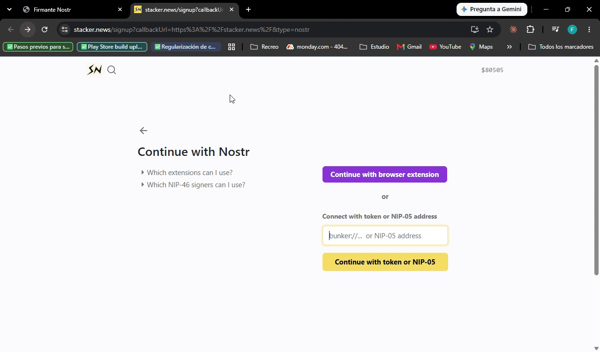

# nostr-signer: firmante remoto Nostr (NIP-46) para iniciar sesión en Stacker News

App local en Python que guarda tu clave Nostr (nsec) **cifrada** y firma por ti, **solo cuando tú lo apruebas**,
el inicio de sesión de Stacker News. Le das a SN un enlace `bunker://`; tu clave nunca sale de tu computador.

## Requisitos

- Python 3.12 (probado en Windows 11; usa solo librerías multiplataforma).
- Conexión a internet (para el relay Nostr).

## Instalación

    python -m venv .venv
    .venv\Scripts\pip install -r requirements.txt        (Linux/macOS: .venv/bin/pip)

Dependencias: `aiohttp`, `coincurve` y `cryptography`. No hay frameworks de frontend.

## Correr

    .venv\Scripts\python app.py          → abre http://localhost:8000

Variable opcional: `NOSTR_RELAY` (por defecto `wss://relay.damus.io`). Ejemplo en PowerShell:
`$env:NOSTR_RELAY="wss://nos.lol"; .venv\Scripts\python app.py`.

Pruebas (53, más subtests: cifrado con **todos** los vectores oficiales de NIP-44, almacén, firmante y servidor):

    .venv\Scripts\python -m unittest -v

Cliente de prueba que imita a Stacker News, sin abrir el sitio (pega el enlace que muestra la app):

    .venv\Scripts\python herramientas\sn_falso.py "bunker://..."           (--kind 1, --secret-malo, --nip44…)

## Uso con Stacker News (3 pasos)

1. Abre http://localhost:8000, crea una clave nueva (o importa tu nsec) y elige una contraseña.
   La próxima vez solo la desbloqueas.
2. Copia el enlace `bunker://…` y pégalo en
   [la página de login de Stacker News](https://stacker.news/signup?callbackUrl=https%3A%2F%2Fstacker.news%2F&type=nostr),
   en *Connect with token or NIP-05 address* → *Login with token or NIP-05*.
3. Vuelve a la pestaña del firmante y pulsa **Aprobar e iniciar sesión**.

**Prueba real:** 2026-11-04, login en stacker.news de punta a punta con una clave de prueba, relay
`wss://relay.damus.io`. La NDK de producción aceptó el `"ack"` y siguió el orden que leímos en la 2.12.2
(`connect` → `get_public_key` → `sign_event` kind 27235). No se registró si el pedido llegó en NIP-04 o NIP-44:
el firmante responde en el mismo esquema, así que funciona con cualquiera de los dos.

## La ambigüedad principal: NIP-04 vs NIP-44

La spec NIP-46 dice que los mensajes van cifrados con **NIP-44**, pero leyendo el código de Stacker News y de
su librería (NDK 2.12.2) vimos que **SN cifra con NIP-04** y solo cambia a NIP-44 si recibe una respuesta sin
`?iv=`. Además, NDK exige que `connect` responda exactamente `"ack"` (la spec permite devolver el secret, y eso
rompe el login) y manda `params = ["", secret]`.

**Resolución:** se implementaron los dos esquemas y el firmante **responde con el mismo con que llegó el
pedido** (`"?iv="` en el contenido → NIP-04; el `?` no existe en base64, así que la detección es inequívoca).
Así funciona con SN hoy y con clientes que sigan la spec. Detalle y fuentes (archivo y línea): `docs/DISENO.md` §2.

## Supuestos

- Un solo usuario, en su propio computador. La app escucha solo en `127.0.0.1`.
- Lo que se firma es un **login**: kind 27235 (NIP-98) con tags `u` y `method`. Supuesto: otras webs con
  login Nostr estándar usan ese mismo kind.
- SN usa solo el relay que trae el `bunker://` y espera la firma sin límite de tiempo (muestra un aviso a los 10 s).
- Los mensajes NIP-46 (kind 24133) son efímeros: el relay no los guarda. Por eso el enlace se muestra solo
  cuando ya estamos suscritos.
- Si olvidas la contraseña no hay recuperación: se borra `data/clave.json` y se importa la nsec de nuevo.

## Tradeoffs

| Tema | Decisión | Tradeoff |
|---|---|---|
| Clave en disco | `data/clave.json` cifrada con **scrypt** (n=2¹⁷) + **ChaCha20-Poly1305** | Robar el archivo no basta. Formato propio: NIP-49 usa XChaCha20, que `cryptography` no trae. |
| Clave del bunker | La **misma** clave del usuario | Lo más simple; la pubkey del usuario queda visible en el relay como firmante. |
| Relay | Uno solo, `relay.damus.io` (configurable) | Sin redundancia. damus limita la tasa por IP: hay reintento acotado (5 y 15 s). |
| Secret del enlace | De **un solo uso**, se rota tras cada `connect` | Para volver a iniciar sesión hay que copiar el enlace nuevo (la página lo avisa). |
| Clientes autorizados | Conjunto en memoria | NDK crea una clave nueva por intento; se borra al cerrar la app. |
| Qué se firma | **Solo** kind 27235; todo lo demás se rechaza sin preguntar | La clave no puede firmar notas, perfiles ni zaps ni por un clic equivocado. La tarjeta muestra el sitio en grande. |
| Aprobación | Manual, un pedido a la vez, expira a los 120 s | Más simple que una cola. |
| Página ↔ programa | **Server-Sent Events** + POST | Sin consultar cada segundo y sin librerías; un WebSocket local sería más código. |
| Seguridad local | Token por arranque en `X-Token`, revisión de `Host` y `Origin`, CSP sin inline | Si reinicias `app.py`, la página vieja pide recargar. |

## Qué quedó fuera

`nip04_encrypt/decrypt`, `nip44_*`, `get_relays`, `switch_relays`, el flujo `nostrconnect://`, NIP-49, varios usuarios,
varios relays, permisos finos, recuperar la contraseña, volver a ver la nsec después del alta, sonido y cola de pedidos.

## Estructura

    app.py                    servidor aiohttp: página, API, SSE y middleware de seguridad
    firmante.py               lógica NIP-46: métodos, clientes autorizados, pedido pendiente, historial
    relay.py                  cliente WebSocket al relay: suscribir, publicar, reconectar
    almacen.py                data/clave.json cifrada (scrypt + ChaCha20-Poly1305)
    nostr/                    bech32, claves, eventos (NIP-01), nip04, nip44
    static/                   index.html, app.css, app.js (sin frameworks)
    tests/                    unittest + vectores oficiales de NIP-44
    herramientas/sn_falso.py  cliente que imita a Stacker News (NDK 2.12.2)

## Documentación y trabajo con IA

- [docs/DISENO.md](docs/DISENO.md): fuente de verdad (hechos verificados, decisiones, protocolo, seguridad, UI).
- [docs/FLUJO.md](docs/FLUJO.md): diagramas del flujo completo.
- [docs/ai-logs/](docs/ai-logs/): conversaciones con el agente (Claude Code). Primero, una "mesa" de 3 subagentes
  expertos (protocolo, seguridad y UX) propuso un diseño y lo revisó en cruz (`mesa-diseno/`). Después se implementó
  por etapas con [docs/PROMPT_IMPLEMENTACION.md](docs/PROMPT_IMPLEMENTACION.md), verificando cada una.
