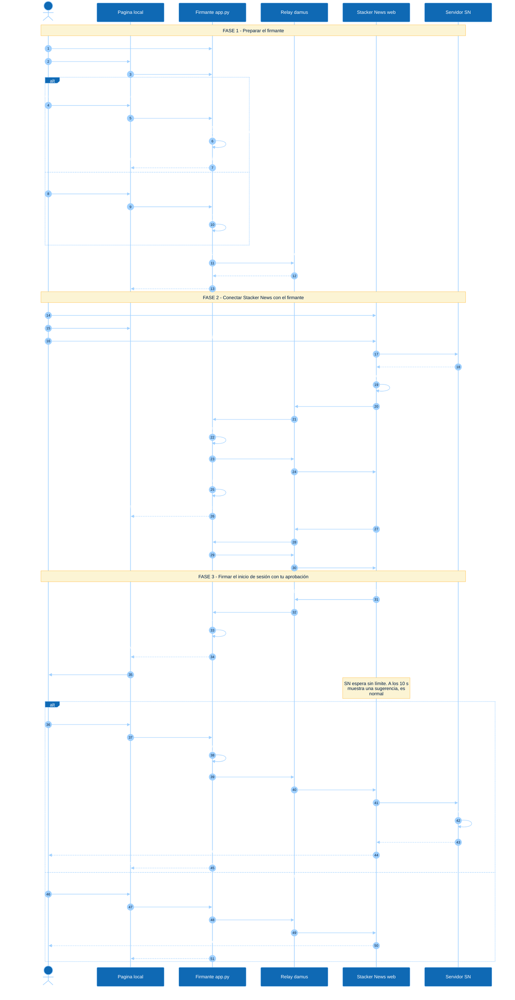
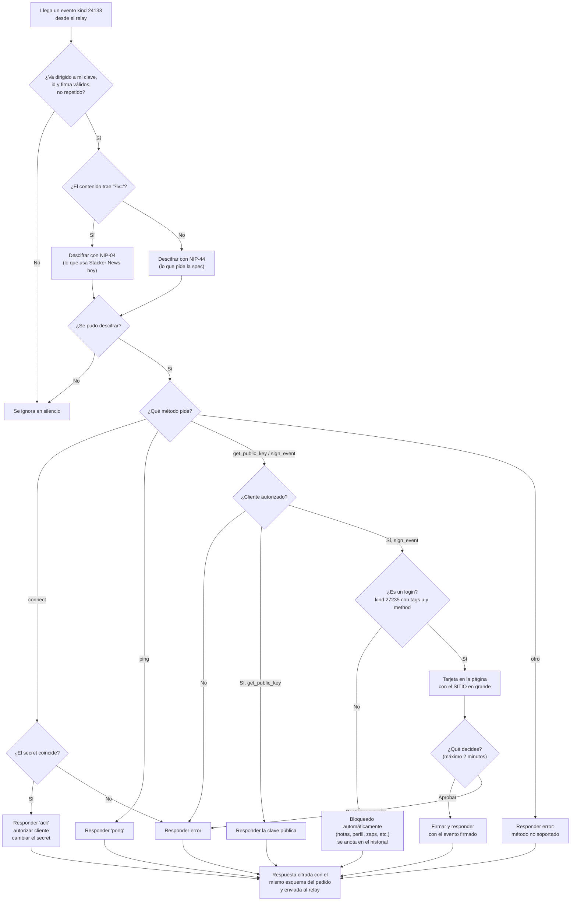

# Flujo completo: iniciar sesión en Stacker News con el firmante

> Los diagramas están en [Mermaid](https://mermaid.js.org/): GitHub y VS Code los dibujan automáticamente
> (en VS Code: vista previa de Markdown, `Ctrl+Shift+V`). El detalle técnico de cada paso está en [DISENO.md](DISENO.md).

## 1. Diagrama de secuencia (de punta a punta)

Participantes:
- **Tú**: la persona usuaria.
- **Página local**: http://localhost:8000.
- **Firmante**: `app.py` + `firmante.py`, con la clave en memoria.
- **Relay**: `wss://relay.damus.io`, que solo reenvía mensajes cifrados.
- **Stacker News (web)**: la página de SN en tu navegador, que usa la librería NDK.
- **Servidor SN**: el backend de stacker.news.

## 2. Qué revisa el firmante con cada mensaje que llega

## 3. Glosario rápido

| Término | Qué es |
|---|---|
| **nsec / npub** | Tu clave secreta y tu clave pública, en formato legible. La npub se puede compartir; la nsec, nunca. |
| **Relay** | Servidor público que reenvía mensajes. Solo ve mensajes cifrados. |
| **bunker://** | Enlace que le dice a una app dónde está tu firmante (tu npub, el relay y un secret). |
| **kind 24133** | Tipo de evento que transporta los mensajes NIP-46 entre la app y el firmante. |
| **kind 27235** | Tipo de evento de login HTTP (NIP-98). Es lo único que este firmante acepta firmar. |
| **challenge** | Código de un solo uso que inventa Stacker News. Evita que una firma vieja sirva para entrar de nuevo. |
| **NIP-04 / NIP-44** | Dos formas de cifrar los mensajes. SN usa NIP-04 hoy; la spec pide NIP-44. Soportamos las dos. |
| **SSE** | Canal por el que el programa local avisa a la página de las novedades, sin preguntar a cada rato. |
